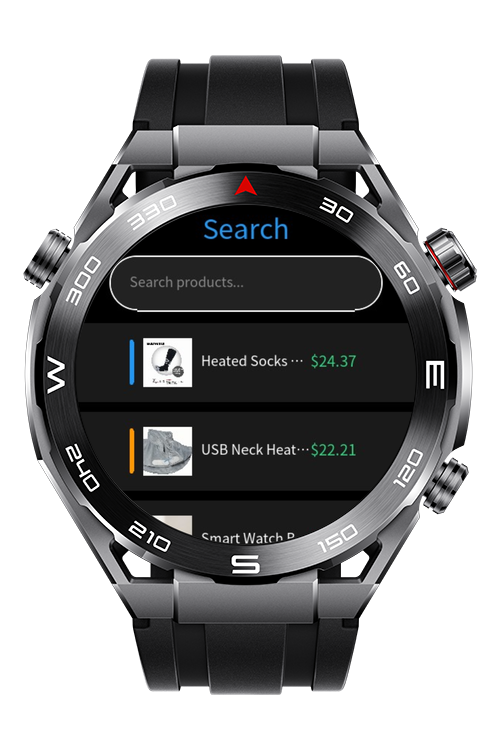
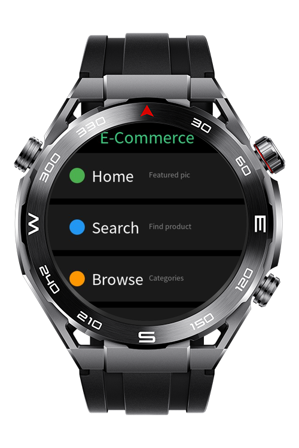
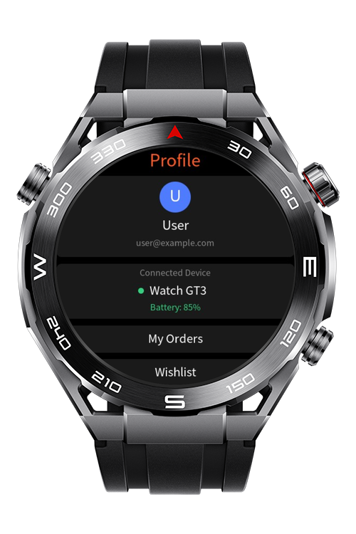
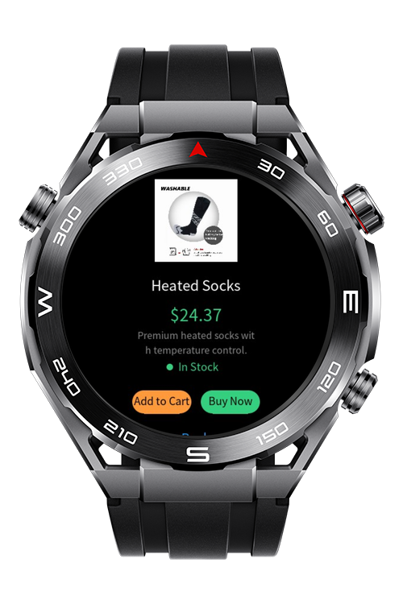

> **Note:** To access all shared projects, get information about environment setup, and view other guides, please visit [Explore-In-HMOS Index](https://github.com/Explore-In-HMOS/hmos-index).

# E-Commerce Sportwatch

**E-Commerce Sportwatch** is a fully functional e-commerce shopping application designed for HarmonyOS Lite Wearable devices. It provides users with a complete shopping experience directly from their smartwatch, including product browsing, search, cart management, checkout, and order tracking.

# Preview

<div>
  
  
  
  
</div>

# Use Cases

* To browse and shop products directly from a smartwatch without needing a phone.
* To quickly search for products using the **Search** feature with instant results.
* To view detailed product information including multiple images in a **Swiper** gallery.
* To manage a shopping cart with add, remove, and quantity update capabilities.
* To complete purchases through a streamlined **Checkout** flow.
* To track order status and view order history in the **Orders** section.
* To manage account settings and preferences in the **Profile** and **Settings** screens.

# Tech Stack

* **Languages:** JavaScript (ES6)
* **Markup:** HML (HarmonyOS Markup Language)
* **Styling:** CSS
* **Frameworks:** HarmonyOS Lite Wearable SDK
* **Tools:** DevEco Studio
* **Router:** @ohos.router

# Directory Structure

```
ECommerce/
├── entry/
│   └── src/
│       └── main/
│           └── js/
│               └── MainAbility/
│                   ├── app.js
│                   ├── data/
│                   │   └── images/
│                   └── pages/
│                       ├── index/
│                       │   ├── index.hml
│                       │   ├── index.js
│                       │   └── index.css
│                       ├── home/
│                       │   ├── home.hml
│                       │   ├── home.js
│                       │   └── home.css
│                       ├── menu/
│                       │   ├── menu.hml
│                       │   ├── menu.js
│                       │   └── menu.css
│                       ├── search/
│                       │   ├── search.hml
│                       │   ├── search.js
│                       │   └── search.css
│                       ├── subcategories/
│                       │   ├── subcategories.hml
│                       │   ├── subcategories.js
│                       │   └── subcategories.css
│                       ├── productList/
│                       │   ├── productList.hml
│                       │   ├── productList.js
│                       │   └── productList.css
│                       ├── productDetail/
│                       │   ├── productDetail.hml
│                       │   ├── productDetail.js
│                       │   └── productDetail.css
│                       ├── cart/
│                       │   ├── cart.hml
│                       │   ├── cart.js
│                       │   └── cart.css
│                       ├── checkout/
│                       │   ├── checkout.hml
│                       │   ├── checkout.js
│                       │   └── checkout.css
│                       ├── orderConfirmation/
│                       │   ├── orderConfirmation.hml
│                       │   ├── orderConfirmation.js
│                       │   └── orderConfirmation.css
│                       ├── orders/
│                       │   ├── orders.hml
│                       │   ├── orders.js
│                       │   └── orders.css
│                       ├── orderDetail/
│                       │   ├── orderDetail.hml
│                       │   ├── orderDetail.js
│                       │   └── orderDetail.css
│                       ├── profile/
│                       │   ├── profile.hml
│                       │   ├── profile.js
│                       │   └── profile.css
│                       └── settings/
│                           ├── settings.hml
│                           ├── settings.js
│                           └── settings.css
```

# Constraints and Restrictions

## Supported Devices

* Huawei Sport (Lite) Watch GT 4/5/6
* Huawei Sport (Lite) GT4/5 Pro
* Huawei Sport (Lite) Fit 3/4
* Huawei Sport (Lite) D2
* Huawei Sport (Lite) Ultimate

# LICENSE

E-Commerce is distributed under the terms of the MIT License.
See the [LICENSE](LICENSE) for more information.
